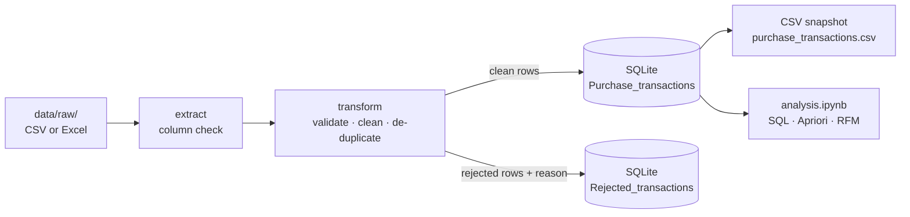

# Retail Data Pipeline

An end-to-end, **on-premises** data platform for a European online retailer. The repository contains:

- the target data architecture, warehouse schema and infrastructure requirements;
- a tested Python ETL pipeline that validates, cleans and loads invoice data into a SQL database;
- analytics on the loaded data: SQL queries, market basket analysis (Apriori) and RFM customer segmentation.

The design constraints are **no cloud services** and **one SQL-based central repository** that employees can query according to their role.

## Pipeline at a Glance



The target architecture replaces SQLite with a PostgreSQL star-schema warehouse. The [architecture document](docs/architecture.md#7-implementation-status) lists which components are implemented today and which are planned.

## Project Structure

```text
retail-data-pipeline/
├── analysis/
│   └── analysis.ipynb          # SQL queries, market basket analysis, RFM segmentation
├── data/
│   ├── raw/                    # Source files (not committed)
│   └── processed/              # Invoice_Records.db + CSV snapshot (not committed)
├── docs/
│   ├── architecture.md         # Target architecture and implementation status
│   ├── data_warehouse.md       # Star schema, ERD and design decisions
│   ├── erd.png                 # ERD rendered from sql/retail_dw.dbml
│   └── infrastructure.md       # On-premises infrastructure requirements
├── sql/
│   ├── create_schema.sql       # PostgreSQL DDL; non-destructive and idempotent
│   ├── retail_dw.dbml          # Schema in DBML, for dbdiagram.io
│   ├── dev/reset_schema.sql    # Drop and rebuild; development databases only
│   └── migrations/             # Numbered, data-preserving schema changes
├── src/retail_pipeline/
│   ├── config.py               # Paths, table names, cleaning settings
│   ├── extract.py              # Read CSV/Excel from disk or URL
│   ├── transform.py            # Validation and cleaning rules
│   ├── load.py                 # Transactional full/incremental load, query helpers
│   ├── pipeline.py             # CLI entry point (retail-etl)
│   └── analytics.py            # Apriori association rules, RFM scoring
├── tests/                      # pytest suite
├── pyproject.toml              # Dependencies (uv) and tool configuration
├── uv.lock                     # Locked dependency versions
└── requirements.txt            # Export of uv.lock for pip users
```

## Dataset

**Online Retail**, UCI Machine Learning Repository:
<https://archive.ics.uci.edu/dataset/352/online+retail>

The dataset contains all transactions of a UK-based, non-store online retailer between 01/12/2010 and 09/12/2011: 541,909 invoice lines with 8 attributes (`InvoiceNo, StockCode, Description, Quantity, InvoiceDate, UnitPrice, CustomerID, Country`).

| File in `data/raw/` | Content |
| --- | --- |
| `Online Retail.xlsx` | Full dataset as published |
| `invoice_records.csv` | Subset of 24,180 lines from 8 European countries, excluding the UK; default pipeline input |

Download the Excel file from the link above and place it in `data/raw/`. Data files are excluded from Git.

> Chen, D. (2015). *Online Retail* [Dataset]. UCI Machine Learning Repository. <https://doi.org/10.24432/C5BW33>

## Getting Started

Requirements: Python 3.12 and [uv](https://docs.astral.sh/uv/).

```bash
uv sync          # create .venv and install all dependencies from uv.lock
uv run retail-etl  # run the pipeline on data/raw/invoice_records.csv
```

With pip instead of uv: `python -m venv .venv && .venv/bin/pip install -r requirements.txt && .venv/bin/pip install -e .`

## Running the Pipeline

```bash
# Default input: data/raw/invoice_records.csv → data/processed/Invoice_Records.db
uv run retail-etl

# Another file, or a file on an internal server
uv run retail-etl --source "data/raw/Online Retail.xlsx"
uv run retail-etl --source "https://<internal-server>/exports/invoices.csv"

# Incremental batch containing only new or changed invoices
uv run retail-etl --source "data/raw/<daily-export>.csv" --mode incremental

# All options
uv run retail-etl --help
```

Each run logs the number of rows read, loaded and rejected, with a breakdown by reject reason. On the full dataset an end-to-end run takes about 20 seconds, most of which is spent reading the Excel file.

### Outputs

| Output | Content |
| --- | --- |
| `Purchase_transactions` table | Clean rows with the columns `InvoiceNo, StockCode, Description, Quantity, InvoiceDate, UnitPrice, CustomerID, Country` |
| `Rejected_transactions` table | Rows rejected by the latest run, exactly as received from the source, with a `RejectReason` column |
| `purchase_transactions.csv` | Snapshot of the whole `Purchase_transactions` table after the load |

All three outputs are written to `data/processed/`. The two tables are in the SQLite database `Invoice_Records.db`.

### Validation and Cleaning Rules

Rules are evaluated in the order below. A row that fails a rule is rejected and labelled with the first rule it fails; malformed values never stop a run.

| Reject reason | Condition | Sample CSV | Full dataset |
| --- | --- | ---: | ---: |
| `missing_required_field` | `InvoiceNo`, `StockCode`, `Quantity`, `InvoiceDate` or `UnitPrice` is empty | 0 | 0 |
| `invalid_invoice_date` | `InvoiceDate` cannot be parsed | 0 | 0 |
| `invalid_numeric_value` | `Quantity`, `UnitPrice` or `CustomerID` is not a finite number, or `Quantity` or `CustomerID` is not a whole number | 0 | 0 |
| `credit_invoice` | `InvoiceNo` starts with `C` (cancellation) | 742 | 9,288 |
| `non_product_code` | `StockCode` is `C2`, `D`, `M` or `POST` (carriage, discount, manual, postage) | 827 | 1,599 |
| `missing_customer_id` | `CustomerID` is empty | 191 | 134,620 |
| `non_positive_quantity` | `Quantity` ≤ 0 | 0 | 0 |
| `non_positive_price` | `UnitPrice` ≤ 0 | 3 | 34 |
| `duplicate_row` | Exact copy of an earlier valid row; the first copy is kept | 36 | 5,187 |
| **Clean rows** | | **22,381** / 24,180 | **391,181** / 541,909 |

The non-product codes are configured in `NON_PRODUCT_CODES` in [`config.py`](src/retail_pipeline/config.py).

### Load Modes

| `--mode` | Source contains | Behaviour |
| --- | --- | --- |
| `full` (default) | A complete snapshot of all invoices | The table is replaced and always equals the latest snapshot |
| `incremental` | Only new or changed invoices | Every invoice in the **raw** batch replaces all stored lines of that invoice. This includes invoices whose new lines were all rejected: their outdated lines are removed. Other invoices are kept, and re-running a batch creates no duplicates |

Both modes write the batch to a staging table first and then swap it in or merge it within a single transaction. A failed run therefore leaves the existing table unchanged.

## Analysis

[`analysis/analysis.ipynb`](analysis/analysis.ipynb) reads the loaded table and covers four topics:

1. **Revenue by country:** an SQL aggregation over all clean transactions.
2. **Country extract:** all transactions for Germany (8,643 rows), loaded into a DataFrame.
3. **Market basket analysis:** Apriori on the 443 German invoices with a minimum support of 5%. The strongest rule is *RED RETROSPOT CHARLOTTE BAG → WOODLAND CHARLOTTE BAG*, with 84% confidence and a lift of 6.4. Rules like this are candidates for product bundles and cross-selling.
4. **RFM segmentation:** customers are scored 1–4 on recency, frequency and monetary value and grouped into four segments: Champions, Loyal, Potential and At risk. Each segment points to a different marketing action.

Open the notebook in VS Code with the `.venv` kernel, or run `uv run --with jupyterlab jupyter lab analysis/analysis.ipynb`.

## Data Warehouse (PostgreSQL)

The target warehouse is a star schema: one fact table (`fact_sales`) and five dimension tables (customer, product, seller, country and date). It is described in [docs/data_warehouse.md](docs/data_warehouse.md).

```bash
# Create the schema; non-destructive, safe on a database that holds data
psql -d retail_dw -f sql/create_schema.sql

# Development only: drop and rebuild (requires the database name as confirmation)
psql -d retail_dw_dev -v confirm_reset=retail_dw_dev -f sql/dev/reset_schema.sql
```

Schema changes after the initial version are applied as numbered migrations; see [`sql/migrations/`](sql/migrations/README.md).

## Development

[Ruff](https://docs.astral.sh/ruff/) is used as linter, import sorter and formatter. It replaces flake8, isort and black.

```bash
uv run pytest                 # test suite
uv run ruff check .           # lint, including import order
uv run ruff check . --fix     # apply automatic fixes
uv run ruff format .          # format (black-compatible)
uvx pyright src tests         # static type check (uses pandas-stubs)
```

The test suite covers:

- **Cleaning rules:** every reject reason, including malformed numbers, dates and missing fields.
- **Load modes:** full replacement, incremental merge, idempotent re-runs, removal of invoices whose lines were all rejected, and rollback on failure.
- **Pipeline:** end-to-end runs, and checking that the CSV snapshot matches the table.
- **Analytics:** the one-hot basket table, and RFM scoring for empty, small and regular inputs.

## Documentation

| Document | Content |
| --- | --- |
| [Data architecture](docs/architecture.md) | Layers, data flow, cleaning strategy, technology stack and implementation status |
| [Data warehouse schema](docs/data_warehouse.md) | Star schema, ERD, design decisions and the `mart.sales_invoice` view |
| [Infrastructure requirements](docs/infrastructure.md) | Requirements per stage, hardware sizing, security, backup and disaster recovery |

## License

Released under the [MIT License](LICENSE).
