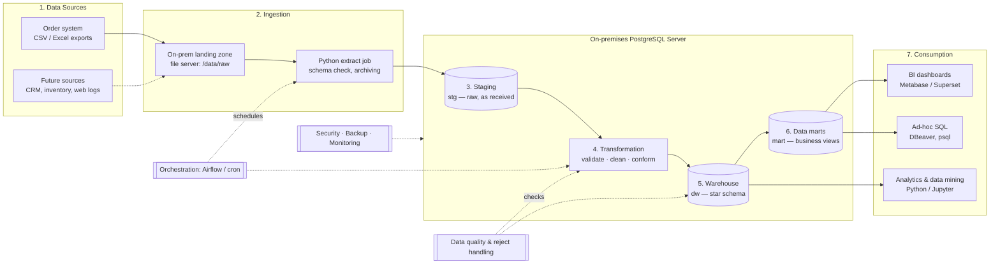
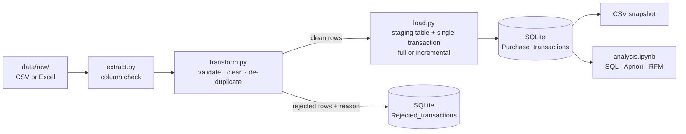

# Data Architecture — European Online Retail Company

> **Scope.** This document describes the **target** on-premises architecture, which is built around a PostgreSQL data warehouse. [Section 7](#7-implementation-status) shows which components are **implemented** in this repository and which are **planned**. In short, the current release is a tested Python ETL pipeline that loads an analysis-ready table into SQLite. The PostgreSQL schema is defined and tested, but no data is loaded into it yet.

## 1. Requirements and Design Decisions

| Requirement | Design decision |
| --- | --- |
| No cloud services for storage or processing | All components run on company-owned servers in the company's own server room or data centre |
| One SQL-based central repository | A single **PostgreSQL** data warehouse is the single source of truth |
| Every employee can access the data they need | Role-based access control (RBAC) in the database, read-only reporting views and a self-service BI tool |
| Reliable, repeatable processing | A scheduled batch ETL pipeline in Python, with validation, reject handling and transactional loads |

**Source data:** transactional sales records, 541,909 invoice lines with 8 attributes (`InvoiceNo, StockCode, Description, Quantity, InvoiceDate, UnitPrice, CustomerID, Country`). They cover 01-Dec-2010 to 09-Dec-2011, 38 countries, about 4,400 customers and about 4,100 products.

---

## 2. Architecture Overview

### 2.1 Target Architecture

### 2.2 Current Implementation

The current pipeline implements the extract, transform and load logic of steps 2 and 4. SQLite stands in for the warehouse until the PostgreSQL load (steps 3, 5 and 6) is built.

---

## 3. Layer-by-Layer Description

### Step 1: Data Sources

- **Main source:** daily or periodic exports of invoice lines from the online shop's order system, as CSV or Excel files.
- **Future sources:** CRM customer data, inventory and stock levels, website clickstream, and returns or shipping data.

### Step 2: Ingestion (Extract)

- Source files are delivered to an **on-premises landing zone** on an internal file server, for example `/data/raw/YYYY-MM-DD/`. *Current:* files are read from `data/raw/` or from a URL on an internal server.
- The Python extract job (pandas, openpyxl):
  - checks that all expected columns are present and reads identifiers as text (*implemented*);
  - records file name, row counts and load time in an **ETL audit table** (*planned*; counts are currently written to the run log);
  - moves processed files to `/data/archive/`, so every load can be replayed and audited (*planned*).
- **Batch loading** (nightly) in two modes (*implemented*):
  - **Full:** the export is a complete snapshot, and the target table is replaced.
  - **Incremental:** the export holds only new or changed invoices. Every invoice in the raw batch replaces all stored lines of that invoice. This includes invoices whose new lines were all rejected: their outdated lines are removed. Re-running a batch never duplicates rows.

  Both modes write the batch to a staging table and then switch to the new data in a single transaction. A failed run therefore leaves the existing data unchanged.

### Step 3: Staging Layer (`stg` schema), *planned*

- Raw data is loaded **as received** into `stg.online_retail_raw`, without business logic.
- Staging keeps the source data separate from the cleaned data, makes troubleshooting easier, and allows re-processing without reading the source files again.
- The staging table is truncated and reloaded on each run.

### Step 4: Transformation Layer (Validate, Clean, Conform)

The current pipeline and the target warehouse handle the same data issues differently, because they serve different purposes:

- **Current pipeline (implemented):** produces `Purchase_transactions`, an **analysis-ready table of customer purchases** for basket analysis and RFM. Rows that are not valid customer purchases are **rejected**. Each rejected row is stored with its reason in `Rejected_transactions`, and the number of rejected rows per reason is logged.
- **Target warehouse (planned):** `dw.fact_sales` is the complete record of sales activity. It **keeps and flags** cancellations and anonymous sales so that returns and total revenue can still be reported. Analysis views filter these rows out.

Issue counts are from profiling the full dataset (541,909 rows):

| Issue in source | Rows | Current pipeline (implemented) | Target warehouse (planned) |
| --- | ---: | --- | --- |
| Missing `CustomerID` | 135,080 | Rejected: `missing_customer_id` | Kept and mapped to the "Unknown customer" (key -1); excluded from RFM |
| Cancellations (`InvoiceNo` starts with "C") | 9,288 | Rejected: `credit_invoice` | Kept with `is_cancelled = TRUE` for returns analysis; excluded from net sales |
| `Quantity` ≤ 0 on a regular invoice | — | Rejected: `non_positive_quantity` | Sent to the reject table |
| `UnitPrice` ≤ 0 | 2,517 | Rejected: `non_positive_price` | Rejected; also enforced by `CHECK (unit_price > 0)` |
| Exact duplicate rows | 5,268 | Rejected: `duplicate_row`; the first copy is kept | Removed |
| Missing required field, unparseable date | — | Rejected: `missing_required_field`, `invalid_invoice_date` | Sent to the reject table |
| Malformed `Quantity`, `UnitPrice` or `CustomerID` | — | Rejected: `invalid_numeric_value` | Sent to the reject table |
| Missing `Description` | 1,454 | Kept as received | Filled with the most frequent description of the same `StockCode` |
| Non-product codes | — | `C2`, `D`, `M` and `POST` rejected (`non_product_code`); other codes such as `BANK CHARGES` are kept | All flagged with `is_non_product` and excluded from product analytics |

The row counts are taken on the raw data, before any other rule is applied, so one row can appear in more than one line. The pipeline's own counts per reject reason are listed in the [README](../README.md#validation-and-cleaning-rules).

Further transformations:

- *Implemented:* trim whitespace in `Description`; convert `Quantity`, `UnitPrice` and `CustomerID` to numeric types; parse `InvoiceDate` to a timestamp.
- *Planned:* derive `line_total` and date attributes, generate surrogate keys, look up dimension keys, and write rejected rows to `stg.rejected_rows`.

### Step 5: Data Warehouse Layer (`dw` schema), *schema implemented, loading planned*

A **star schema** optimised for analytical queries, described in detail in [data_warehouse.md](data_warehouse.md):

| Table | Content |
| --- | --- |
| `dw.fact_sales` | One row per invoice line: quantity, unit price, line total, cancellation flag |
| `dw.dim_customer` | Customer ID; reserved attributes for CRM data |
| `dw.dim_product` | Stock code, description, inventory attributes, non-product flag |
| `dw.dim_seller` | Seller or sales channel |
| `dw.dim_country` | Country and region of the invoice |
| `dw.dim_date` | Calendar attributes |

- Foreign-key and date indexes; the fact table can be partitioned by month as it grows.
- Dimensions are **SCD Type 1** (values are overwritten). They can move to Type 2 if history must be tracked.

### Step 6: Data Marts and Semantic Layer (`mart` schema)

Business-facing views and materialized views:

| View | Status |
| --- | --- |
| `mart.sales_invoice`: invoice lines with the standard columns `InvoiceNo … Country` | Implemented (DDL) |
| `mart.sales_by_country_month` | Planned |
| `mart.top_products` | Planned |
| `mart.customer_rfm` | Planned |
| `mart.cancellations_summary` | Planned |

Employees query these documented views instead of the underlying tables.

### Step 7: Consumption (Analytics and Data Mining)

| Users | Tool | Access |
| --- | --- | --- |
| Management, Sales, Marketing | Metabase or Apache Superset (self-hosted) | Read-only on `mart` |
| Analysts | SQL clients (DBeaver, psql) | Read-only on `dw` and `mart` |
| Data scientists | Python and Jupyter (pandas, scikit-learn, mlxtend) | Read-only on `dw`, plus their own sandbox schema |
| Data engineers | Python ETL, Airflow | Read and write on all schemas |

Use cases: sales trends and seasonality, country and product performance, **market basket analysis** (Apriori association rules), **RFM customer segmentation**, and cancellation and return analysis.

*Implemented* in `analysis/analysis.ipynb`, on the SQLite table: revenue by country, the country extract, Apriori rules, and RFM segmentation with quartile scores. *Planned:* K-Means clustering on RFM values, and cancellation and return analysis. The latter needs the warehouse, because the current table excludes cancellations.

---

## 4. Cross-Cutting Components

- **Orchestration:** Apache Airflow (self-hosted), or cron in a first phase. A nightly DAG runs `extract → stage → transform → load → quality checks → refresh marts`.
- **Data quality:** row-level validation with reject reasons (*implemented*). Post-load checks (*planned*): row counts against the source, no NULL foreign keys, no negative net totals. A failed check stops the run and sends an alert.
- **Security and access:** PostgreSQL roles (`role_reader`, `role_analyst`, `role_engineer`) linked to the company LDAP or Active Directory; TLS on the internal network; access to customer identifiers restricted for GDPR.
- **Backup and recovery:** nightly `pg_dump` and continuous WAL archiving to a separate on-premises backup server; restores are tested regularly; the raw-file archive is retained.
- **Monitoring and logging:** an ETL audit table (run ID, start and end time, rows read, loaded and rejected, status); server monitoring with Prometheus and Grafana.
- **Metadata:** a data dictionary for every table and column, maintained as `COMMENT ON` statements in the database.

---

## 5. Technology Stack (on-premises, open source)

| Layer | Technology |
| --- | --- |
| Raw file storage | Internal file server / NAS |
| Central repository | PostgreSQL 16 or later |
| ETL | Python 3.12 (pandas; psycopg for the PostgreSQL load) |
| Orchestration | Apache Airflow (or cron) |
| BI and reporting | Metabase or Apache Superset |
| Analytics and data mining | Jupyter, pandas, mlxtend, scikit-learn |
| Version control | Git (self-hosted Gitea or GitLab CE) |
| Development tooling | uv, Ruff, pytest, Pyright |

---

## 6. End-to-End Data Flow (Target)

1. The order system exports sales data to the **landing zone**.
2. The **extract** job checks the file, loads it into **staging** and logs the run.
3. The **transformation** validates, cleans, de-duplicates, flags and enriches the data, and writes rejected rows to a reject table.
4. The cleaned data is **loaded** into the **star-schema warehouse**: dimension tables first, then the fact table.
5. **Data-quality checks** run and the **data marts** are refreshed.
6. Employees access the data through **BI dashboards, SQL clients and notebooks**, with permissions set by their role.
7. **Backups, monitoring and audit logs** keep the platform reliable and compliant.

---

## 7. Implementation Status

| Component | Status | Location |
| --- | --- | --- |
| Extract from CSV/Excel (file or URL) with column check | Implemented | `src/retail_pipeline/extract.py` |
| Row validation and cleaning with reject reasons and counts | Implemented | `src/retail_pipeline/transform.py` |
| Full and incremental load: staging table, single transaction, idempotent | Implemented (SQLite) | `src/retail_pipeline/load.py` |
| Reject table of the latest run | Implemented (SQLite) | `src/retail_pipeline/pipeline.py` |
| CSV snapshot of the loaded table | Implemented | `data/processed/purchase_transactions.csv` |
| PostgreSQL star schema and `mart.sales_invoice` view | DDL implemented and tested; no data loaded yet | `sql/create_schema.sql` |
| SQL queries, Apriori, RFM (quartile scores) | Implemented | `src/retail_pipeline/analytics.py`, `analysis/analysis.ipynb` |
| Automated tests, linting, formatting, type checking | Implemented | `tests/`, Ruff, Pyright |
| PostgreSQL load (`stg` → `dw` → `mart`) | Planned | — |
| Warehouse rules: keep and flag cancellations and anonymous sales | Planned | — |
| ETL audit table, file archive | Planned | — |
| Orchestration and alerting | Planned | — |
| RBAC, backups, monitoring, BI tool | Planned; see [infrastructure.md](infrastructure.md) | — |
