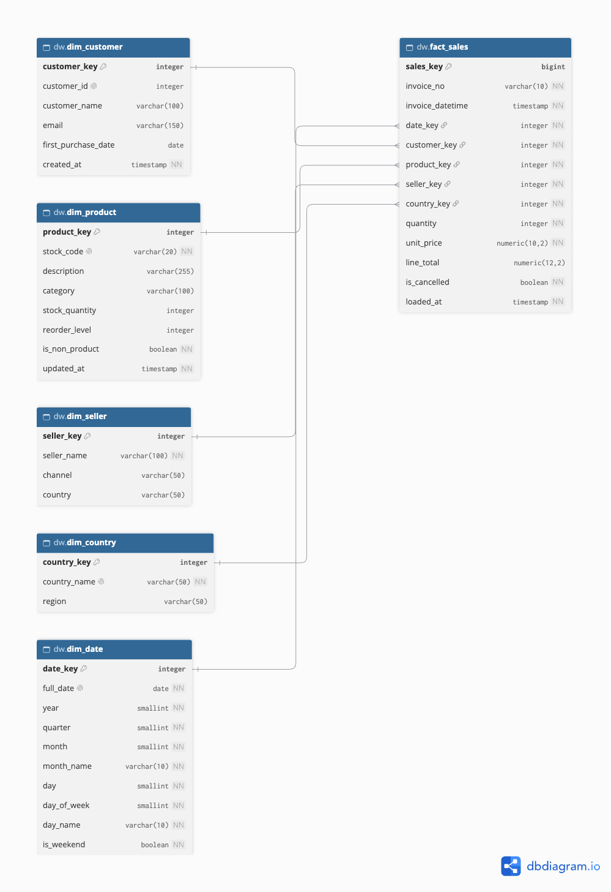
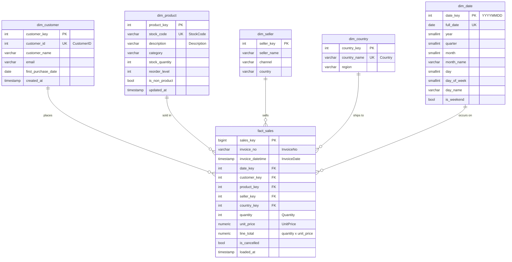

# Data Warehouse Schema & ERD — Online Retail

> **Status.** The schema is implemented as PostgreSQL DDL ([`sql/create_schema.sql`](../sql/create_schema.sql)) and has been tested. Loading data into it is planned. The current pipeline loads an analysis-ready table into SQLite; see [architecture.md](architecture.md#7-implementation-status).

## 1. Business Requirements

1. Record **customer**, **seller**, **inventory** and **transaction invoice** information.
2. Provide a sales-invoice record with the columns `InvoiceNo, StockCode, Description, Quantity, InvoiceDate, UnitPrice, CustomerID, Country`.

## 2. Design: Star Schema

The warehouse is a **star schema**. A central fact table holds the measurable sales events, and five dimension tables hold their descriptive context. Every dimension is one join away from the fact table, which keeps analytical queries simple and fast.

- **Grain (one row in the fact table):** one invoice line, meaning one product on one invoice.
- **Schema:** `dw` holds the warehouse tables; `mart` holds the business-facing view.

The design is based on the following findings from profiling the source data:

| Finding in data | Design consequence |
| --- | --- |
| Each invoice has exactly 1 country, but 8 customers appear under 2+ countries | Country is linked to the **sale** (`dim_country`), not stored on the customer |
| 3,603 stock codes are sold at more than one price | `unit_price` is stored on the **fact line**, not on the product |
| 650 stock codes have more than one description | `dim_product.description` holds the most frequent description for each code |
| 43 invoices have lines with different timestamps | `invoice_datetime` is stored on each fact line |
| 135k lines have no `CustomerID` | These lines point to an "Unknown customer" row (key = -1) |
| Cancellations and non-product lines (postage, discounts) are part of the sales history | Kept in the fact table and flagged (`is_cancelled`, `dim_product.is_non_product`) instead of being removed |

## 3. Tables

| Table | Requirement | Key columns | Purpose |
| --- | --- | --- | --- |
| `dim_customer` | Customer info | `customer_key` PK, `customer_id` (CustomerID) | One row per customer. Name, e-mail and first-purchase date are reserved for CRM data |
| `dim_product` | Inventory info | `product_key` PK, `stock_code` (StockCode), `description` | Product catalogue plus stock level, reorder level and a non-product flag |
| `dim_seller` | Seller info | `seller_key` PK, `seller_name`, `channel` | Seller or sales channel. The source data has a single online store (key = 1) |
| `dim_country` | — | `country_key` PK, `country_name` (Country), `region` | Shipping or billing country of the invoice |
| `dim_date` | — | `date_key` PK (YYYYMMDD) | Calendar attributes for time analysis |
| `fact_sales` | Invoice info | `sales_key` PK, `invoice_no` (InvoiceNo), 5 foreign keys, `quantity`, `unit_price`, `line_total`, `is_cancelled` | One row per invoice line |

## 4. ERD



The diagram is rendered from [`sql/retail_dw.dbml`](../sql/retail_dw.dbml); paste the file into [dbdiagram.io](https://dbdiagram.io) to view or edit it. The same model is shown below in Mermaid, which renders directly on GitHub. Quoted labels are the corresponding source columns.



## 5. Sales-Invoice View

The view `mart.sales_invoice` joins the fact table to its dimensions and returns the sales-invoice record in the standard column layout:

| Column | Source |
| --- | --- |
| `InvoiceNo` | `fact_sales.invoice_no` |
| `StockCode` | `dim_product.stock_code` |
| `Description` | `dim_product.description` |
| `Quantity` | `fact_sales.quantity` |
| `InvoiceDate` | `fact_sales.invoice_datetime` |
| `UnitPrice` | `fact_sales.unit_price` |
| `CustomerID` | `dim_customer.customer_id` |
| `Country` | `dim_country.country_name` |

```sql
SELECT * FROM mart.sales_invoice LIMIT 10;
```

## 6. Implementation Files

| File | Purpose |
| --- | --- |
| [`sql/create_schema.sql`](../sql/create_schema.sql) | Creates all schemas, tables, keys, indexes and the view. It is non-destructive and idempotent (`IF NOT EXISTS`, `ON CONFLICT DO NOTHING`), so it is safe on a database that holds data. Tested on PostgreSQL 17; requires PostgreSQL 12 or later for generated columns |
| [`sql/migrations/`](../sql/migrations/README.md) | Numbered, data-preserving schema changes after the initial version |
| [`sql/dev/reset_schema.sql`](../sql/dev/reset_schema.sql) | Drops and rebuilds the schemas; for development databases only, and requires the database name as confirmation |
| [`sql/retail_dw.dbml`](../sql/retail_dw.dbml) | The same model in DBML, the source of [`erd.png`](erd.png) |
